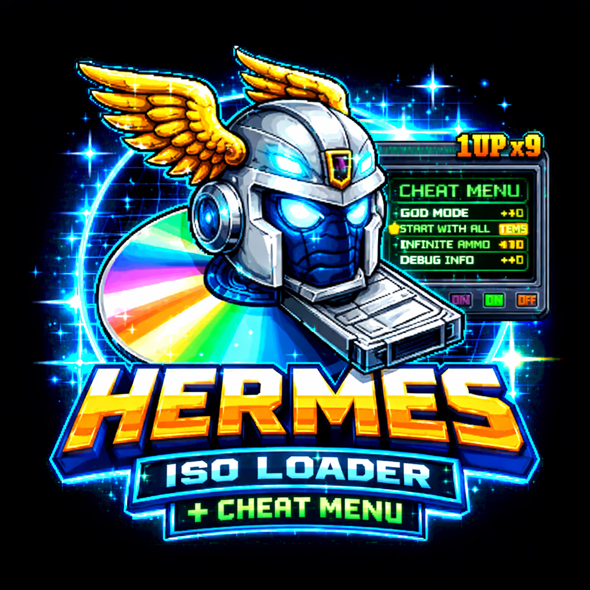
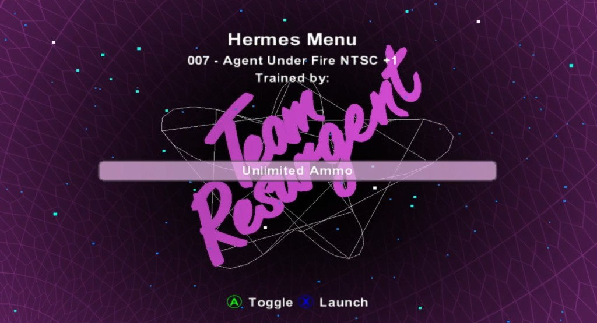

<p align="center">
  
</p>

<p align="center"><b>An original Xbox trainer menu for EvolutionX <code>.etm</code> files and virtual game images</b></p>

<p align="center">
  <a href="https://discord.gg/VcdSfajQGK"></a>
</p>

<p align="center">
  <a href="https://ko-fi.com/J3J7L5UMN"></a>
  <a href="https://www.patreon.com/teamresurgent"></a>
</p>

An original Xbox XBE that a dashboard launches into a game folder. It reads
`trainer.etm`, lets you toggle the trainer options, installs that trainer into
memory that survives a soft reboot, then attaches the folder's disc image so the
BIOS boots the game with those options applied.

<p align="center">
  
</p>

A dashboard must launch it with title launch data whose magic is `0x54525452`
and whose path is the game folder. A cold boot without that data returns to the
dashboard. If `trainer.etm` is missing, or it has no toggleable options, Hermes
Menu returns to the dashboard as well.

## Controls

The same actions are available from a controller or the DVD remote.

| Input | Action |
| --- | --- |
| D-Pad Up / Down | Move the selection (up to 7 options on screen) |
| A | Toggle the selected trainer option |
| X | Install the trainer, attach the image, and launch |

The first two strings in the `.etm` are the header lines. Everything after that
is a toggle.

## How it works

1. **Launch data** — reads the mount path from the dashboard's
   `CUSTOM_LAUNCH_ISO_DATA` block.
2. **Trainer** — loads `trainer.etm` from that folder and parses the EvolutionX
   selection table (option flags, text offsets, and title IDs).
3. **Scene** — draws a textured sphere, a morphing wireframe, a spinning STL
   logo, and a starfield, with FreeSans text and looping Ogg music.
4. **Install** — on launch, `Patcher` hooks the kernel's XBE entry and copies
   the ETM loader plus the trainer into a 2400-byte contiguous block placed
   below the kernel, persisted across the soft reboot.
5. **Attach** — `IsoChecker` collects and validates the image slices, then
   `IsoAttacher` mounts them on the virtual drive and reboots into the game.

### Image attach

The kernel build selects the virtual-disc path. Build **8008** and newer is
treated as Cerbios.

| BIOS | Files used | Attach |
| --- | --- | --- |
| **Cerbios** (build ≥ 8008) | `.iso`, `.cci` | `IOCTL_VIRTUAL_ATTACH` on `\Device\Virtual0\Image0`, mounted at `\Device\CdRom0`. `.cci` is sent as device type `d`, everything else as `D`. Then a soft reboot. |
| **Legacy** | `.iso`, `.cso` | `IOCTL_VIRTUAL_CDROM_ATTACH` on `\Device\CdRom1`. IND-BIOS builds 5003 and 5004 remap `D:` onto `\Device\CdRom0` and launch `D:\default.xbe`. Other legacy BIOS builds soft-reboot. |

`.cci` is skipped on legacy BIOS. `.cso` is skipped on Cerbios. A folder should
hold one image type.

#### Slices

One image file is attached as-is. Several slices must agree before they are
sorted and attached in order:

- The same number of dot-separated name parts, and the same filename length.
- A numeric slice index in the part just before the extension.
- A matching name prefix across every file.

A folder that fails those checks reboots to the dashboard instead of attaching.

### Display

`main` picks the first mode the console reports that it can show:

| Mode | Notes |
| --- | --- |
| 1280×720 progressive | 16:9, 60 Hz, when 720p is available |
| 720×480 / 640×480 progressive | 16:9 or 4:3, when 480p is available |
| 720×480 / 640×480 interlaced | 50 Hz on PAL, 60 Hz on NTSC / PAL-60, 16:9 or 4:3 |

The UI is laid out in a 720×480 buffer on top of that mode.

## Requirements

- Original Xbox, launched by a dashboard that passes Hermes launch data
  (`0x54525452` plus the game folder path)
- Cerbios (kernel build 8008 or newer) for `.cci`, or a legacy BIOS with virtual
  CD support for `.iso` and `.cso`
- Microsoft Xbox XDK with Visual Studio .NET 2003 (Xbox VC 7.10 project)

## Build

Open `HermesMenu.sln` in the Xbox XDK and build **Release | Xbox**.

The image tool writes `HermesMenu/Release/default.xbe` (title **Hermes Menu**,
title ID `0x5452FFFF`). Debug builds land in `HermesMenu/Debug/`.

The XBE title image is `HermesMenu/titleimage.xpr`. Rebuild it from the logo
with the XDK bundler:

```bat
cd Artwork
runme.bat
```

`Artwork/titleimage.rdf` packs `Logo.bmp` as a 128×128 DXT1 texture.

## Project layout

```
HermesMenu.sln                 Xbox solution
HermesMenu/                    XBE project
  main.cpp                     Entry, display modes, 3D scene, main loop
  Menu.cpp / Menu.h            Option list, input, launch
  Trainer.cpp / Trainer.h      Load trainer.etm and toggle options
  Patcher.cpp / Patcher.h      Install the ETM loader below the kernel
  IsoChecker.cpp / IsoChecker.h
                               Find, validate, and sort image slices
  IsoAttacher.cpp / IsoAttacher.h
                               Legacy virtual CD and Cerbios virtual attach
  inputManager.cpp             Controller and DVD remote
  drawing.cpp / theme.cpp / component.cpp
                               Fonts, skin, option buttons
  audioPlayer.cpp              Looping Ogg via DirectSound (stb_vorbis)
  stl_loader.cpp / meshUtility.cpp
                               STL logo mesh and scene geometry
  Assets/                      Embedded font, base texture, logo mesh, music
  titleimage.xpr               XBE title image
Artwork/
  Logo.png / Logo.bmp          Logo art
  screenshot.jpg               Menu screenshot
  titleimage.rdf / runme.bat   Bundler script for the title image
```

## Notes

- Launch installs the trainer by patching the kernel XBE entry and keeping a
  contiguous allocation alive across the soft reboot that starts the game. That
  is the EvolutionX `.etm` loader (2400-byte heap, the same size EvoX allows).
- Only `trainer.etm` and the image files in the launch folder are read. Mixed
  slice names, a missing slice number, or no images at all send the console
  back to the dashboard.
- Let the attach finish. Pulling power while the virtual disc is being mounted
  leaves that boot unfinished; a failed attach already returns to the dashboard
  on its own.
